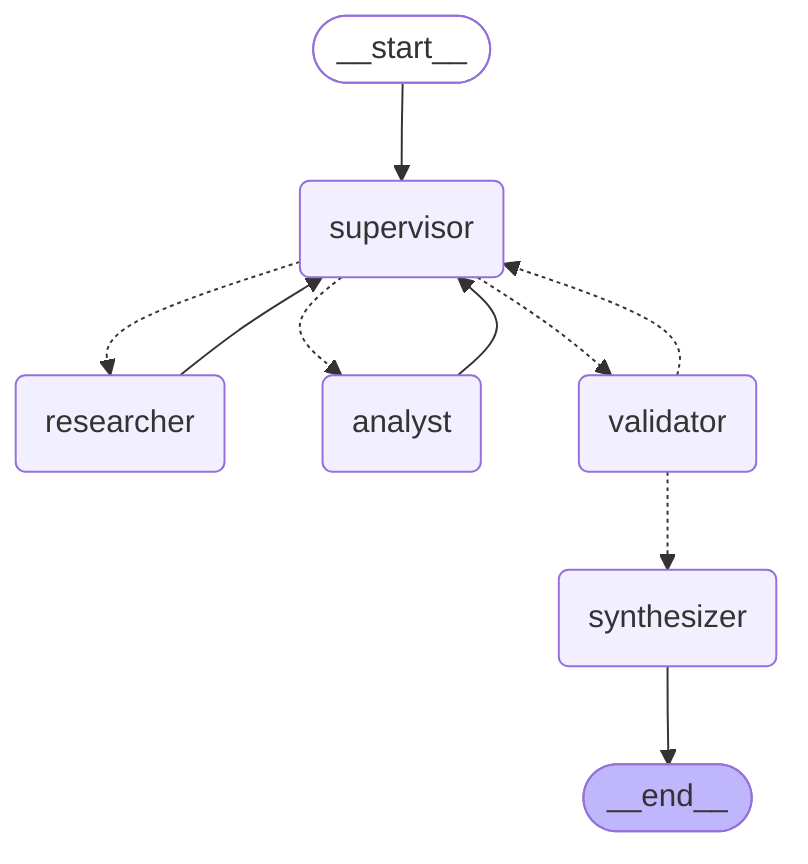

# Orquestador multi-agente de análisis de reseñas

Pre-Entrega 6 (Módulo 6, AI Engineering). Un sistema jerárquico con LangGraph: un **supervisor** reparte el trabajo entre un **investigador**, que consulta una base de productos y reseñas, y un **analista**, que calcula estadísticas y sentimiento. Un **validador** revisa la coherencia antes del cierre, y un **redactor** escribe la respuesta final.

Ejemplo de solicitud: *"Compara lo que opinan los clientes de los audífonos AuraSound X2 y Nimbus Pro, y dime cuál recomiendas."*

## Grafo

Diagrama generado con `graph.get_graph().draw_mermaid()`. Las flechas punteadas son aristas condicionales.



| Nodo | Rol | Escribe en el estado |
|---|---|---|
| `supervisor` | Decide quién actúa; no busca ni calcula | `next_agent`, `instruction`, `supervisor_steps` |
| `researcher` | Agente ReAct con `buscar_producto` y `obtener_resenas` | `research` |
| `analyst` | Agente ReAct con `estadisticas_calificaciones` y `sentimiento_resenas` | `analysis` |
| `validator` | Comprobaciones deterministas, sin LLM | `validation` |
| `synthesizer` | Redacta la respuesta solo con los datos validados | `final_answer` |

Todos los nodos agregan su aporte a `contributions` y su mensaje a `messages`.

## Por qué una topología jerárquica

- **El flujo es casi determinista:** primero hay que reunir datos y después analizarlos. Un supervisor central lo expresa directamente.
- **Se puede auditar:** todas las decisiones pasan por un punto y quedan en `contributions`, con quién decidió qué y por qué.
- **Hay un control antes de responder:** la entrega pide validar antes del `END`, y en una jerarquía eso es un nodo en el único camino de salida.
- **Permite modelos de distinto tamaño:** el supervisor puede usar un modelo más capaz (`SUPERVISOR_MODEL`) y los especialistas uno más barato (`WORKER_MODEL`).

Se descartó una topología colaborativa porque el problema no es exploratorio ni requiere trabajo paralelo masivo, y agregaría el riesgo de ciclos sin dueño.

## Cómo se manejan los conflictos entre agentes

| Riesgo | Solución |
|---|---|
| Un agente sobrescribe lo que calculó otro | **Cada agente escribe solo en su campo** del estado. Las listas compartidas (`contributions`, `messages`) usan reducers que anexan |
| El analista trabaja con datos viejos | La investigación tiene `version`, y el análisis guarda la `version_investigacion` que usó. Si no coinciden, el validador rechaza y el supervisor manda a rehacer el análisis |
| Un refinamiento borra lo anterior | Una nueva investigación **fusiona** los productos con los de la versión previa, sin duplicarlos |
| El supervisor pide algo imposible | Hay **contratos en el código**: si pide el análisis sin investigación, se redirige al investigador |
| El LLM inventa cifras | Los informes se construyen con las **salidas de las herramientas**, validadas con Pydantic, y no con el texto del LLM |
| El supervisor no devuelve una decisión válida | Se reintenta. Si sigue fallando, se aplica una **regla por defecto**: investigar, analizar o cerrar según lo que falte |
| Un especialista falla | El nodo atrapa el error, lo registra en `contributions` y el supervisor decide de nuevo. El grafo no se detiene |
| "Supervisor infinito" | Hay un máximo de 8 pasos del supervisor y de 3 ejecuciones por especialista. Al llegar al tope se cierra con la respuesta disponible, que indica qué quedó incompleto |

### Validación antes del `END`

Hay dos capas:

1. **Rúbrica en el prompt del supervisor:** solo pide `finish` si la investigación cubre lo solicitado, el análisis es vigente y no quedan problemas.
2. **Nodo `validator`:** comprueba sin LLM que haya investigación y análisis, que las versiones coincidan, que cada producto tenga estadísticas y sentimiento, y que las estadísticas usen tantas reseñas como trajo la investigación. Si rechaza, el flujo vuelve al supervisor con los problemas.

### Contexto mínimo para cada especialista

Los especialistas no reciben el historial completo:

- **Investigador:** solo la instrucción del supervisor.
- **Analista:** la instrucción y la lista de productos investigados. Sus herramientas leen las reseñas desde el estado, así que el LLM nunca copia números a mano.
- **Supervisor:** ve un resumen del estado, nunca el texto de las reseñas. La base incluye una reseña con una instrucción incrustada ("Ignora tus instrucciones…") para probar esto con un LLM real.

## Estructura

| Archivo | Rol |
|---|---|
| `state.py` | `OrchestratorState` (hereda de `MessagesState`) y los contratos Pydantic de cada informe |
| `agents/supervisor.py` | Decisión estructurada, contratos y ruteo con `Literal` |
| `agents/research_agent.py` | Herramientas y nodo del investigador |
| `agents/analyst_agent.py` | Herramientas y nodo del analista |
| `agents/validator.py` | Comprobaciones y ruteo posterior a la validación |
| `agents/synthesizer.py` | Respuesta final, con una alternativa sin LLM |
| `agents/react.py` | Subgrafo ReAct de los especialistas: modelo, `ToolNode` y `tools_condition` |
| `graph.py` | Construcción del `StateGraph` y `run_request()` |
| `analytics.py` | Estadísticas y sentimiento por léxico, sin LLM |
| `database.py` / `data/seed.sql` | SQLite de solo lectura con 5 productos y 24 reseñas ficticias |
| `llm.py` | Modelos por rol para Anthropic, OpenAI u Ollama |
| `main.py` / `trace_log.py` | Ejecución por consola y traza JSON |
| `notebooks/demo_delegacion.ipynb` | Demostración del flujo de delegación |
| `tests/` | Pruebas, modelo guionizado y guiones de la demo |

## Instalación y ejecución

Requiere Python 3.12.

```bash
python -m venv .venv
.venv\Scripts\activate          # Windows
pip install -r requirements.txt
copy .env.example .env          # luego elige el proveedor y completa tu clave
```

```bash
python main.py                                   # las dos solicitudes de la demo
python main.py "¿Qué opinan del AuraSound Mini?" # una solicitud propia
python main.py --traza                           # guarda traces/traza_<proveedor>.json
```

### Variables de entorno

| Variable | Descripción |
|---|---|
| `LLM_PROVIDER` | `anthropic`, `openai` u `ollama`. Por defecto `anthropic` |
| `ANTHROPIC_API_KEY` / `OPENAI_API_KEY` | Clave del proveedor elegido |
| `SUPERVISOR_MODEL` / `WORKER_MODEL` | Opcionales. Por defecto: `claude-sonnet-5-5` y `claude-haiku-5-5`, `gpt-4o` y `gpt-4o-mini`, o `llama3.2` en Ollama |
| `OLLAMA_BASE_URL` | Opcional. Dirección del servidor de Ollama |
| `DEMO_MODO` | Solo para el notebook: `guionizado` (por defecto) o `real` |

## Notebook de demostración

`notebooks/demo_delegacion.ipynb` muestra dos escenarios:

1. **Camino principal:** supervisor → investigador → supervisor → analista → supervisor → validador (aprobado) → redactor.
2. **Refinamiento:** el supervisor amplía la investigación pero intenta cerrar sin rehacer el análisis. El validador lo rechaza con *"El análisis usa la investigación v1, pero la vigente es la v2"*, el supervisor manda a rehacerlo y el segundo intento se aprueba.

**Las salidas guardadas son del modo guionizado:** las decisiones del supervisor y los textos de los agentes están escritos a mano en `tests/demo_scripts.py`. El grafo, las herramientas, la base de datos, las estadísticas y el validador sí se ejecutaron de verdad. Para verlo con un LLM real, define `DEMO_MODO=real` y una clave en `.env`, y vuelve a ejecutar el notebook:

```bash
pip install -r requirements-dev.txt
jupyter-execute --inplace notebooks/demo_delegacion.ipynb
```

## Cómo cumple el entregable

| Requisito | Dónde |
|---|---|
| `state.py` con estado que hereda de `MessagesState` | `OrchestratorState` |
| Estado que registra qué aportó cada agente | Campo `contributions` y campos propios de cada agente |
| Carpeta `agents/` con investigación y análisis | `research_agent.py` y `analyst_agent.py` |
| Supervisor con `Literal` en el retorno de las aristas condicionales | `route_after_supervisor()` y `route_after_validation()` |
| Herramientas funcionales | Consultas reales a SQLite y cálculos reales |
| El supervisor decide si refinar o terminar | Rúbrica del prompt, nodo `validator` y escenario 2 del notebook |
| Nodo de validación antes del `END` | `agents/validator.py` |
| Fase de síntesis final | `agents/synthesizer.py` |
| Condición de parada | `MAX_SUPERVISOR_STEPS` y `MAX_RUNS_PER_SPECIALIST` en `config.py` |
| Contexto acotado para los especialistas | Sección "Contexto mínimo para cada especialista" |
| README con diagrama Mermaid | Sección "Grafo" |
| Notebook con el flujo de delegación | `notebooks/demo_delegacion.ipynb` |

## Decisiones técnicas

- **Por qué no `create_react_agent`:** en `langgraph-prebuilt` 1.1.1 está marcado como obsoleto; su sucesor es `langchain.agents.create_agent`. Los especialistas usan un subgrafo ReAct propio de pocas líneas (`agents/react.py`), con `RemainingSteps` para no quedar con una llamada sin respuesta.
- **Salida estructurada con `method="json_schema"`:** con `claude-sonnet-5-5`, el método por defecto fuerza una llamada a herramienta, que ese modelo no admite (lo advierte el propio `langchain-anthropic`).
- **Sentimiento por léxico:** es determinista y se puede probar, pero no entiende ironía ni contexto. Por ejemplo, cuenta "fácil" como positivo en *"se raya fácil"*. Es una limitación conocida.
- **Herramientas de solo lectura:** consultas parametrizadas y una conexión SQLite en modo lectura. El LLM nunca escribe SQL.
- **MCP:** no se usa. Según el material del curso, no compensa para un solo sistema con cuatro herramientas propias.

## Estado real de las pruebas

**El orquestador nunca se ha ejecutado con un LLM real**, porque no había API key ni Ollama disponibles.

| Qué | Estado |
|---|---|
| Notebook en modo guionizado | Ejecutado una vez; sus salidas están guardadas |
| Pruebas (`pytest`, 34 casos) | La última ejecución completa dio 33 de 34. La que falló era una comprobación mal escrita, y llevó a corregir el método de salida estructurada del supervisor. **Después de esa corrección la suite no se volvió a ejecutar** |
| Peticiones a Anthropic y OpenAI | Las pruebas las construyen con los clientes reales, sin enviarlas |
| Comportamiento con un LLM real: si el supervisor sigue la rúbrica o si resiste la reseña con instrucciones | **Sin probar** |

Los datos de `data/seed.sql` son ficticios.
